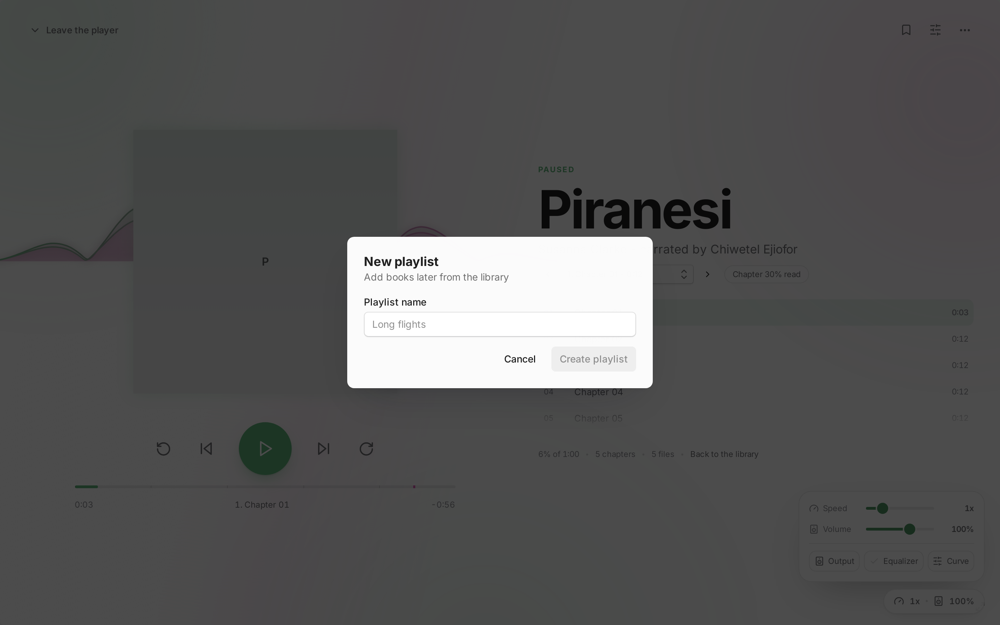
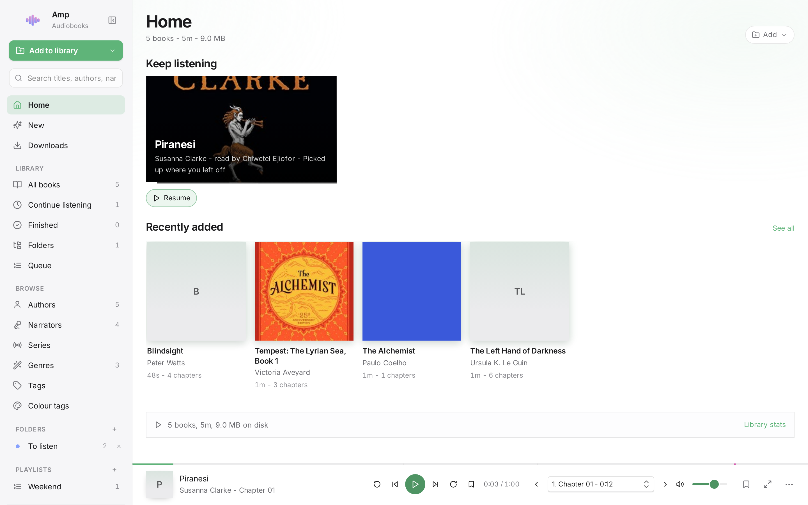
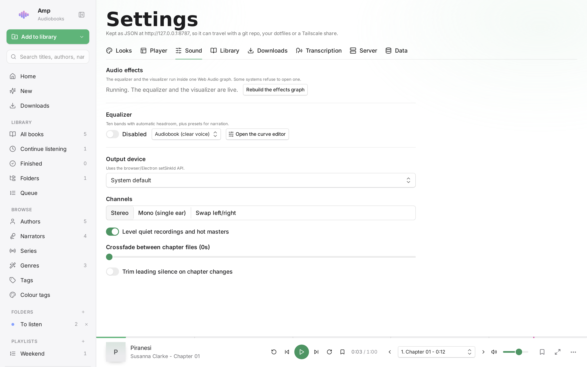

# Amp

A small, fast desktop player for the audiobooks you already own. Amp reads real m4b chapters and
cover art, plays mp3/mp4 and friends, gives you a working equalizer and visualizer, searches
AudioBookBay and hands magnets to qBittorrent, and can stream the whole library to your phone
over Tailscale. No account, no telemetry, no cloud.

Built with Electron, React and TypeScript, with Python companions (a Tkinter GUI, a terminal UI
for downloads and an optional remote server).

[](https://github.com/amp-app/amp/actions/workflows/ci.yml)
[](https://github.com/amp-app/amp/actions/workflows/windows.yml)
[](https://github.com/amp-app/amp/releases)
[](LICENSE)



## Get it

Windows users have two options, both built by the [Windows build workflow](https://github.com/amp-app/amp/actions/workflows/windows.yml):

- **Installer** - `Amp-<version>-setup.exe`. Installs per user, lets you pick the folder, and
  registers Amp in the start menu. The switch to start with Windows is in Settings > Playback.
- **Portable** - `Amp-<version>-portable.exe`. One file, no installer, keeps its library in the
  same place so either build can be swapped for the other.

Tagged releases carry signed-or-unsigned builds for Windows, macOS and Linux with checksums; the
workflow above builds the current `main` without needing a tag. macOS and Linux builds come from
`npm run dist:mac` and `npm run dist:linux`.

<table>
  <tr>
    <td></td>
    <td></td>
  </tr>
  <tr>
    <td align="center">Your own shelf, imported in place, never copied.</td>
    <td align="center">Every visualizer and sound option, in one place.</td>
  </tr>
</table>

```
Library        import files or folders, never copies them
Playback       m4b chapters, speed, equalizer, sleep timer, output switching
Visualizer     wave, bars, and circles that ride the audio around the cover
Look           sidebar-only shell, square covers, adaptive colours, light/dark
Acquisition    AudioBookBay search, qBittorrent queue, .torrent files, finished-download import
Extras         optional local Whisper transcription, Tailscale server, mini player
```

## Quick start

```bash
git clone https://github.com/amp-app/amp
cd amp
npm install

npm run dev            # the renderer in a browser (connects to a server)
npm run dev:desktop    # the real Electron app, with your files
npm run dev:site       # the landing page (static, no build step)
```

Requirements: Node 22.12 or newer for the desktop app (Electron 44 asks for it); Node 20 still
runs the browser build and the Python tools. Running `npm install` finishes with a short
environment check; `npm run doctor` runs it again on demand and `npm run doctor -- --fix`
repairs the Electron binary if its download did not finish (the "Electron uninstall" error).

`ffmpeg` and `ffprobe` are optional (chapter writing, splitting and cover extraction),
qBittorrent is optional (torrents), and Whisper is optional (transcription). Amp detects what is
missing and says so instead of failing silently.

## Scripts

| Command                                   | What it does                                                      |
| ----------------------------------------- | ----------------------------------------------------------------- |
| `npm run dev`                             | Vite dev server for the renderer (port 4321)                      |
| `npm run dev:desktop`                     | Electron with hot reload                                          |
| `npm run dev:site`                        | Serve the static landing page (port 4322)                         |
| `npm run build:web`                       | Build the renderer for the browser                                |
| `npm run site:check`                      | Check the landing page without building it                        |
| `npm run dist`                            | Package installers with electron-builder                          |
| `npm run dist:win` / `dist:mac` / `dist:linux` | Package for one platform only                                |
| `npm test`                                | Vitest for core, ui, renderer and desktop                         |
| `npm run typecheck`                       | TypeScript across every workspace                                 |
| `npm run lint`                            | ESLint                                                            |
| `npm run doctor`                          | Check the environment (`--fix` repairs a missing Electron binary) |
| `npm run icons`                           | Regenerate the app, tray and site icons                           |
| `npm run py:gui` / `py:tui` / `py:server` | Python companions                                                 |
| `npm run py:test`                         | Python unit tests                                                 |

## Layout

```
apps/renderer     React app: library, player, downloads, settings, visualizer
apps/desktop      Electron main process, preload bridge, packaging
apps/website      Animated landing page (plain HTML/CSS/JS, no build step)
packages/core     Pure TypeScript: types, grouping, chapters, keys, EQ, torrents
packages/ui       Components shared by the app and the site
python/           amp_py package plus gui.py, tui.py, server.py
docs/             Architecture, features, shortcuts, release process
```

## The landing page is static

`apps/website` is not a workspace and has no dependencies: `index.html`, one stylesheet and two
plain scripts (`assets/ascii.js`, `assets/site.js`). The ASCII art on the page - the drifting
background field, the rules between sections, the wordmarks, the app window drawn in box
characters and the visualizer itself - is generated in the browser from sine fields and one
canvas read-back, so nothing on the page is a picture of text. Serve the folder with anything
(`npm run dev:site`, or `python -m http.server` inside it) and that is the whole deployment.
`npm run site:check` verifies the folder is complete - every reference resolves, every id the
script reaches for exists, nothing is loaded from another origin - which is what CI runs in place
of a build.

## How it is put together

Amp splits cleanly in two: everything that can be pure logic lives in `packages/core`, where it
is tested without a browser or a filesystem, and everything that needs a machine lives behind
one interface, `AmpBridge` in `packages/core/src/bridge.ts`. The Electron preload script
implements that interface over IPC, the browser build implements it against an Amp server (the
optional remote server, or the Python one), and the Python tools read the same JSON files
directly. Because the contract is one file, the UI does not know or care where it runs.

Audio goes through the Web Audio graph - media element, ten biquad filters, a preamp, a stereo
panner, an analyser and an output gain - which is what makes the equalizer, the visualizer and
output-device switching real rather than decorative.

More detail: [docs/architecture.md](docs/architecture.md) and
[docs/features.md](docs/features.md).

## Python companions

```bash
python python/gui.py            # Tkinter companion: library, search, downloads
python python/tui.py            # terminal UI for AudioBookBay downloads
python python/server.py         # optional remote server for the built web app
python -m pytest python/tests   # standard-library tests, no network needed
```

The Python package uses only the standard library, so it runs on a headless box or inside a
container with no build step. See [python/README.md](python/README.md).

## Documentation

- [Features](docs/features.md) - what each screen does
- [Keyboard shortcuts](docs/keyboard.md) - defaults and how to rebind
- [Torrents](docs/torrents.md) - search, queue, importing finished downloads
- [Transcription](docs/transcription.md) - local Whisper, model choices
- [Remote server](docs/remote-server.md) - Tailscale setup and the HTTP API
- [Python tools](docs/python.md) - GUI, TUI and server
- [Development](docs/development.md) - layout, tests, conventions
- [Release](docs/release.md) - how the workflows publish builds
- [FAQ](docs/faq.md)

## Contributing

Issues and pull requests are welcome. `npm run typecheck`, `npm run lint` and `npm test` should
be green before opening a PR, and the CI workflow runs the same three commands plus the Python
tests and both builds. See [CONTRIBUTING.md](CONTRIBUTING.md).

## License

MIT. Amp is a player: it does not host, index or distribute audiobooks. Search results come from
the public index you configure, downloads happen in the BitTorrent client you already run, and
the files stay on your disk.
